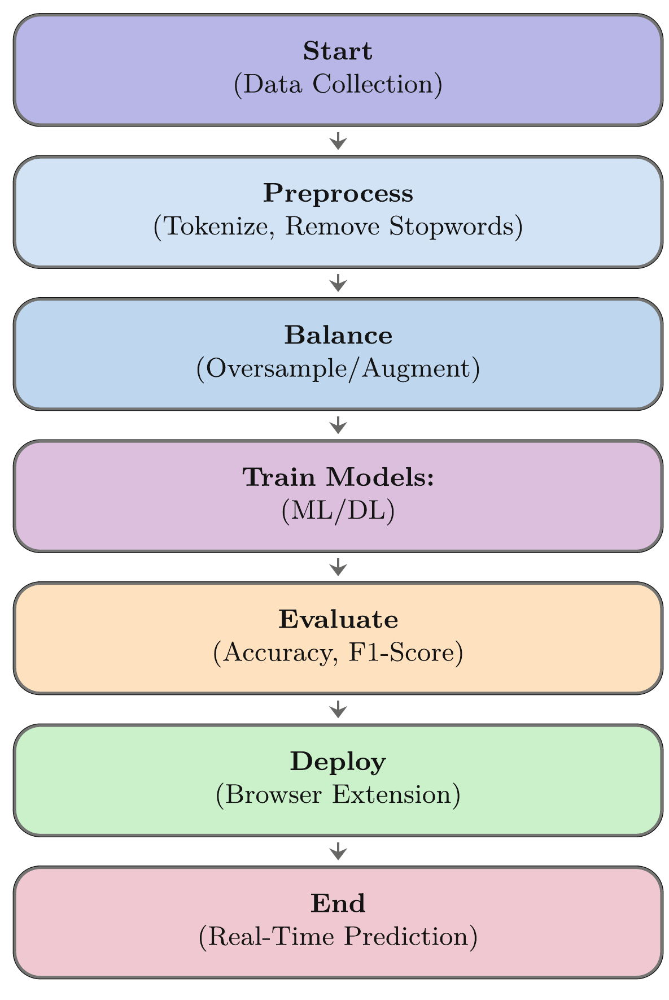
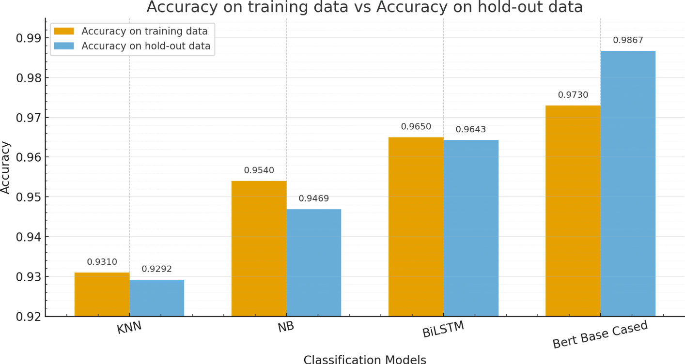
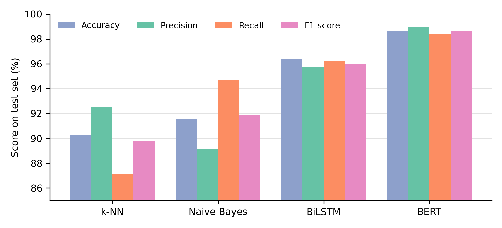
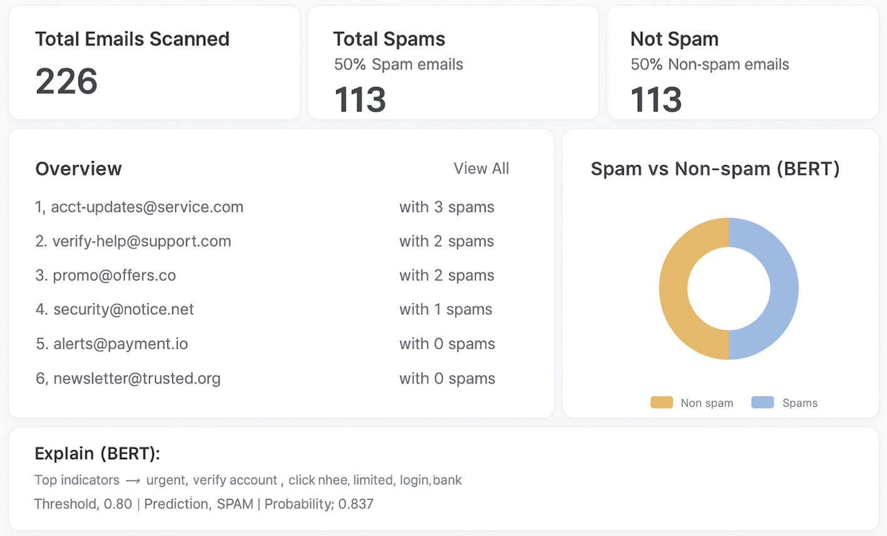

<div align="center">

# BERT-Driven Deep Learning for Enhanced Spam Email Classification with Browser Extension Integration

**Chau Van Van** and **Nguyen Minh Tuan**

Posts and Telecommunications Institute of Technology, Ho Chi Minh City, Vietnam<br>
`{vancv, minhtuan}@ptit.edu.vn`

*Real-Time Intelligent Systems (RTIS 2025)*, Lecture Notes in Networks and Systems, vol. 1936, pp. 167–177, Springer, Cham, 2027

🏆 **Best Paper Award**, The Seventh Conference on Real-time Intelligent Systems (RTIS 2025), November 7–8, 2025, Ho Chi Minh City, Vietnam

[](https://doi.org/10.1007/978-3-032-23396-7_15)
[](https://link.springer.com/chapter/10.1007/978-3-032-23396-7_15)

</div>

**Contents:** [Abstract](#abstract) · [Introduction](#introduction) · [Contributions](#contributions) · [Methodology](#methodology) · [Results](#results) · [Deployment](#browser-extension-deployment) · [Conclusion](#conclusion-and-future-work) · [Citation](#citation)

> The full article is available from Springer:
> **https://link.springer.com/chapter/10.1007/978-3-032-23396-7_15**

---

## Abstract

Email volume continues to surge across business, education, and personal use, with spam composing nearly half of global traffic and driving financial and security risks. Classical filters (blacklists, rules, Naive Bayes, k-Nearest Neighbors) and even deep models like BiLSTM struggle to capture full semantics or resist modern evasion. We propose a BERT-driven spam-detection framework that exploits bidirectional self-attention to model rich context and evaluate it against strong baselines. On a balanced dataset of 5,000 emails with a 226-sample hold-out test set, fine-tuned BERT attains 98.67% accuracy and 98.65% F1, outperforming BiLSTM (96.43%), Naive Bayes (91.59%), and k-NN (90.27%). For practical deployment, we integrate BERT into a Chrome extension with a FastAPI backend, enabling real-time Gmail filtering with 0.5 s latency per email. Results indicate BERT delivers superior accuracy and robustness, bridging research and production. Future directions include multilingual detection, adversarially robust training, and multimodal filtering (URLs, images).

**Keywords:** Deep Learning · Spam Email Detection · Intelligent Information Systems · Privacy and Security

## Introduction

Unsolicited email and phishing keep growing, so filters must be accurate, fast, and easy to use inside the tools people already work with. Spam filtering moved from hand-written rules and blacklists to statistical learners such as Naive Bayes, k-NN, SVM, and Random Forests. Deep models followed: CNNs capture local n-gram patterns, LSTMs and BiLSTMs model longer context, and hybrid CNN–BiLSTM models combine both. BERT replaces recurrence with self-attention and transfers knowledge from large-scale pre-training.

Many published evaluations, however, run in controlled settings, compare against only a few baselines, and pay little attention to deployment metrics such as latency, privacy, and user-interface integration. This paper addresses both sides. It benchmarks BERT against Naive Bayes, k-NN, and BiLSTM, and it deploys the model in a Chrome extension (Manifest V3) backed by FastAPI for real-time Gmail screening.

## Contributions

1. **A benchmark of BERT against ML and DL baselines.** Fine-tuned BERT is compared with Naive Bayes, k-NN, and BiLSTM.
2. **A deployment blueprint.** A Chrome extension and a FastAPI service bring the model into Gmail at real-time latency.
3. **An analysis of practical challenges.** The paper discusses dataset scope and bias, concept drift, multilingual and multimodal threats, and adversarial robustness.

## Methodology

<p align="center">
  
</p>
<p align="center"><b>Fig. 1.</b> Workflow of the proposed system. <a href="figures/fig1_workflow.pdf">[PDF]</a></p>

**Data.** Two public sources were used: the UCI Spambase dataset and a text-based email corpus from Kaggle.

<div align="center">

**Table 2.** Dataset distribution

| Dataset | Ham | Spam | Total |
|---|---:|---:|---:|
| Spambase | 3,856 | 745 | 4,601 |
| Text Corpus | 4,350 | 1,378 | 5,728 |
| Balanced | 3,000 | 2,000 | 5,000 |

</div>

**Preprocessing.** HTML tags, headers, and special characters were removed, followed by stop-word removal and tokenization. Class imbalance was handled with RandomOverSampler and Easy Data Augmentation (EDA). A stratified hold-out set of 226 emails (113 spam, 113 ham) was kept unseen during training.

**Models.**
- **k-NN** with Euclidean distance.
- **Multinomial Naive Bayes** with Laplace smoothing.
- **BiLSTM:** Embedding → BiLSTM → Dense (ReLU) → Dropout → Dense (Sigmoid).
- **BERT:** fine-tuned for binary classification from the `[CLS]` embedding.

<div align="center">

**BERT fine-tuning settings**

| Setting | Value |
|---|---|
| Sequence length | 300 tokens |
| Batch size | 32 |
| Learning rate | 4 × 10⁻⁵ |
| Optimizer | AdamW |
| Epochs | 3 |

**Table 3.** Train / validation / test split

| Set | Ham | Spam | Total |
|---|---:|---:|---:|
| Training (70%) | 2,100 | 1,400 | 3,500 |
| Validation (20%) | 600 | 400 | 1,000 |
| Test (10%) | 300 | 200 | 500 |

</div>

Experiments ran in Python 3.11 with TensorFlow, scikit-learn, and Hugging Face Transformers on a single NVIDIA T4 GPU (16 GB). The random seed was 42, and 8-fold cross-validation was applied.

## Results

<div align="center">

**Table 4.** Performance metrics on the test set (%)

| Model | Accuracy | Precision | Recall | F1-score |
|---|---:|---:|---:|---:|
| k-NN | 90.27 | 92.52 | 87.16 | 89.80 |
| Naive Bayes | 91.59 | 89.17 | 94.69 | 91.88 |
| BiLSTM | 96.43 | 95.76 | 96.24 | 96.00 |
| BERT | 98.67 | 98.95 | 98.35 | 98.65 |

</div>

<p align="center">
  
</p>
<p align="center"><b>Fig. 2.</b> Performance (Accuracy and F1-score).</p>

<p align="center">
  
</p>
<p align="center"><b>Figure.</b> Test-set metrics from Table 4. <a href="figures/table4_model_comparison.pdf">[PDF]</a></p>

Deep models outperformed the classical learners. BERT achieved the highest accuracy and F1-score, improving accuracy by about 2.2 points and F1 by about 2.6 points over BiLSTM. k-NN and Naive Bayes remain lightweight options, but their limited feature representations restrict them against sophisticated spam.

## Browser Extension Deployment

The Chrome extension sends the email body to a FastAPI `predict` endpoint that hosts the fine-tuned BERT model. On the 226-email hold-out set, end-to-end latency from Gmail DOM extraction to the JSON response averaged **0.5 s per email** (median 0.52 s, p95 0.80 s).

<p align="center">
  
</p>
<p align="center"><b>Fig. 3.</b> Chrome Extension for real-time Gmail spam detection.</p>

## Conclusion and Future Work

Under a common protocol of preprocessing, stratified splits, and shared metrics, fine-tuned BERT outperformed BiLSTM, Naive Bayes, and k-NN, reaching 98.67% accuracy and 98.65% F1. The Chrome extension with a FastAPI back end classified an email in about 0.5 s on average, which shows that real-time use is feasible.

**Limitations.**
- Only English, text-only emails were evaluated.
- The balanced corpus may not capture the full diversity and seasonality of spam.
- Latency was measured on a prototype with limited hardware.
- Non-text signals such as URLs, HTML layout, images, and attachments were not used.

**Future work.**
- Multilingual and code-mixed detection with mBERT or XLM-R.
- Non-text cues such as URL reputation, HTML features, OCR, and attachment metadata.
- Adversarial training against evasion.
- Continual and federated learning for concept drift and privacy.
- Distillation, quantization, and batching for efficient deployment.

## Citation

```bibtex
@incollection{van2027bertspam,
  author    = {Van, Chau Van and Tuan, Nguyen Minh},
  title     = {{BERT}-Driven Deep Learning for Enhanced Spam Email Classification with Browser Extension Integration},
  booktitle = {Real-Time Intelligent Systems ({RTIS} 2025)},
  editor    = {Pichappan, Pit and others},
  series    = {Lecture Notes in Networks and Systems},
  volume    = {1936},
  pages     = {167--177},
  publisher = {Springer, Cham},
  year      = {2027},
  doi       = {10.1007/978-3-032-23396-7_15},
  url       = {https://link.springer.com/chapter/10.1007/978-3-032-23396-7_15}
}
```

## Copyright

The article is © The Author(s), under exclusive license to Springer Nature Switzerland AG 2027. This repository reproduces the abstract, the published tables, and the authors' own figures for reference. Please cite and read the version of record via the DOI above.

## Contact

Chau Van Van: vancv@ptit.edu.vn · Nguyen Minh Tuan: minhtuan@ptit.edu.vn<br>
Posts and Telecommunications Institute of Technology, Ho Chi Minh City, Vietnam
